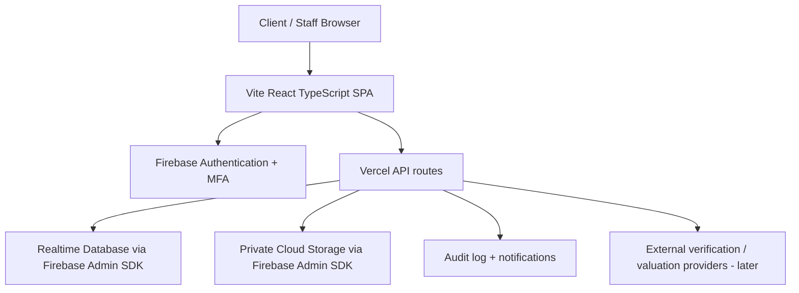

# Technical Architecture & Repository Structure

## High-level architecture


## Trust boundary
Browser is untrusted. Firebase Auth establishes identity; the Vercel API verifies Firebase ID tokens, then checks custom claims plus current RTDB membership/grants. API routes validate schemas, authorize each tenant/entity/asset action, apply state transitions and write audit events using a server-only Admin SDK credential. Clients never directly write approved asset records, reviews, valuations, permissions or audit events. RTDB and Storage rules remain default-deny for browser access.

## Proposed monorepo
```text
private-wealth-registry/
  docs/                       # these markdown files
  apps/web/
    index.html
    vite.config.ts
    src/
      app/                    # providers, router, guards
      pages/public/           # home, services, about, contact, legal
      pages/auth/             # sign-in, sign-up, reset, MFA
      pages/client/           # overview, assets, detail, reports, settings
      pages/admin/            # operations, clients, assets, requests
      pages/reviewer/         # review queue and evidence decisions
      components/ui/          # accessible design system
      components/charts/
      features/assets/
      features/clients/
      features/reviews/
      features/documents/
      features/analytics/
      lib/firebase.ts
      lib/api.ts
      lib/formatters.ts
      types/
      styles/
  api/                        # Vercel serverless API routes
  server/                     # Admin SDK, authentication and authorization services
  scripts/                    # trusted staff provisioning utility
  packages/shared/            # zod schemas, DTOs, status enums
  database.rules.json
  storage.rules
  firebase.json
  .firebaserc
  .env.example
  .github/workflows/
```

## Recommended libraries
React Router; TanStack Query for callable APIs; React Hook Form + Zod; Tailwind CSS; a maintained accessible UI component library; Recharts for charts; Vitest + Testing Library; Playwright for E2E. Choose dependencies based on current maintenance/security review.

## API contracts (illustrative)
- `createTenantAndOnboard(payload)` → tenant ID, onboarding state
- `createAssetDraft(tenantId, payload)` → asset ID
- `submitAssetForReview(tenantId, assetId, expectedVersion)`
- `reviewAsset(tenantId, assetId, decision, rationale, expectedVersion)`
- `addValuation(tenantId, assetId, payload)`
- `requestAssetCorrection(tenantId, assetId, changes)`
- `grantAccess(tenantId, subjectUid, scope, expiry)`
- `createDocumentUpload(tenantId, assetId, metadata)` → short-lived upload capability
- `generatePortfolioReport(tenantId, filters)` → job ID

Every API route verifies auth, role, scope, tenant membership, payload, idempotency and concurrency version; server timestamps and audit entries.

## Firebase configuration
Use separate dev/staging/prod projects, encrypted Vercel environment variables for the Admin SDK credential, least-privilege service accounts, App Check, same-origin API calls, emulator-based rule tests, backup/restore rehearsals and deployment approvals. Environment variables for Firebase web config are public identifiers, not secrets. This deployment uses Vercel API routes instead of Firebase Cloud Functions.

## RTDB vs alternatives
RTDB works for a carefully bounded MVP, but advanced multi-entity consolidation, relational joins, ad-hoc reporting and compliance search can become difficult. Reassess Firestore or PostgreSQL before scaling complex ownership graphs. Keep repository interfaces and reporting services decoupled from the storage engine.
